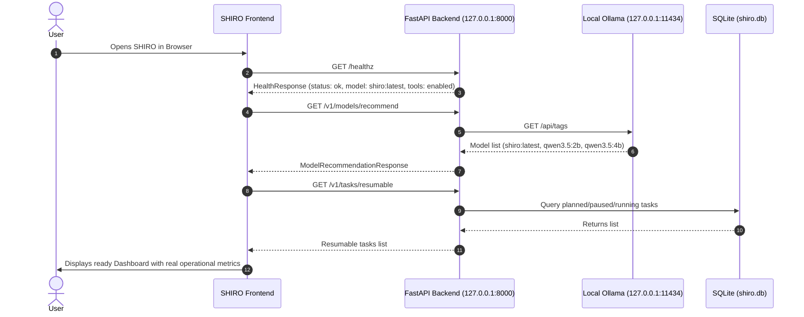
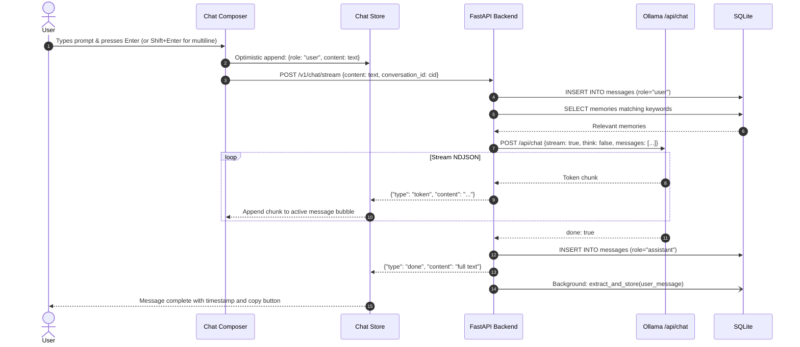
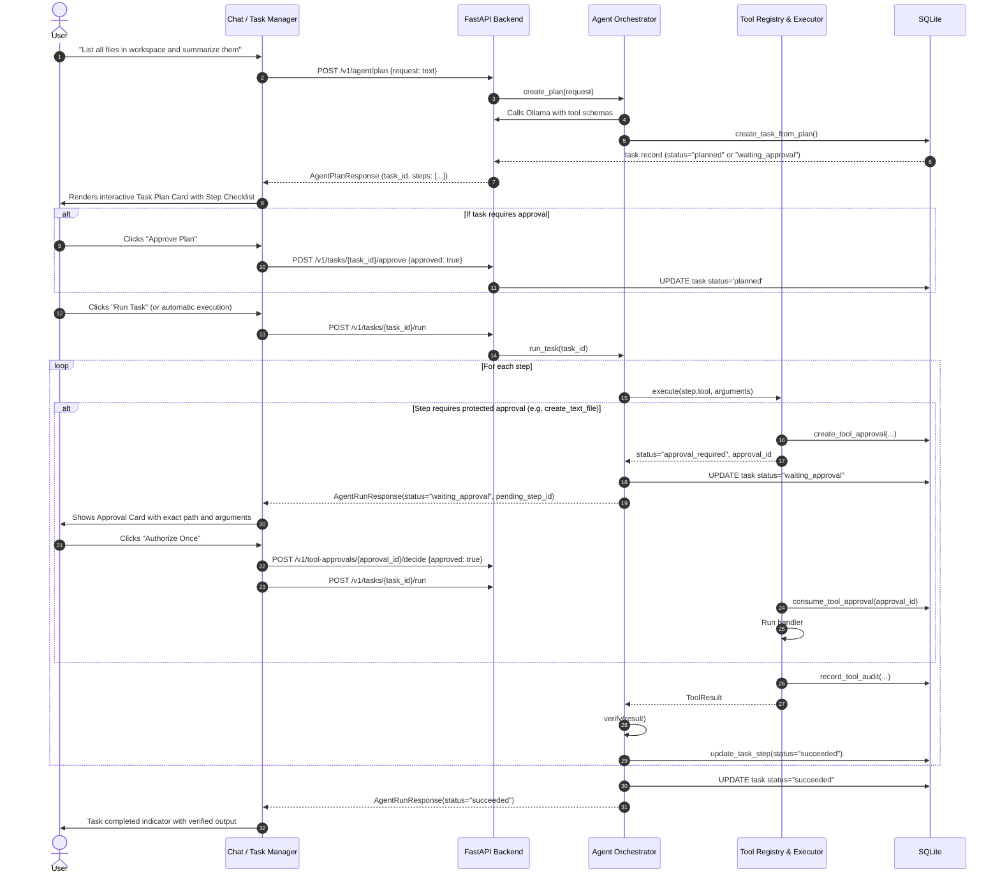
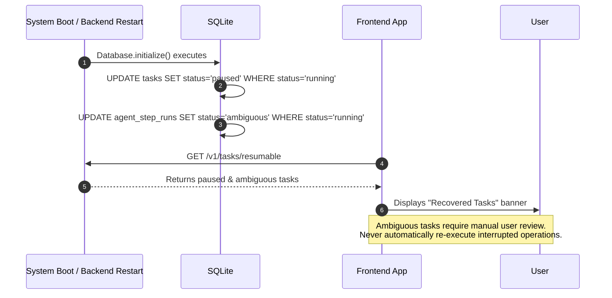

# SHIRO — User Flows & Interaction Specifications

This document outlines the detailed user journeys across SHIRO's primary operating modes: conversation, task execution, tool authorization, memory management, and recovery.

---

## Flow 1: Launch & Session Initialization

### Edge Cases
- **Ollama daemon offline**: Header badge displays red "Ollama Disconnected" pill with instruction: `Run "ollama serve" on Windows`. Chat input is disabled with clear warning.
- **Backend unavailable**: Full-viewport polite reconnect banner with exponential backoff pinging `/healthz`.

---

## Flow 2: Chat & Stream Interaction

---

## Flow 3: Autonomous Task Planning & Execution

---

## Flow 4: Restart & Crash Recovery

